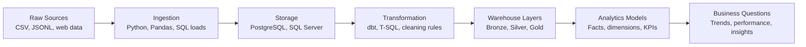
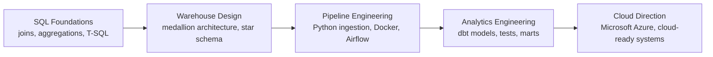

  

<h1 align="center">Data Engineering Portfolio Console</h1>

  

  
  
  

  
  
  
  

  
  
  
  
  

---

## Portfolio Signal

<table>
  <tr>
    <td align="center" width="25%">
      
       
      <b>Pipeline Builder</b>
       
      ETL/ELT, warehouse layers, repeatable workflows
    </td>
    <td align="center" width="25%">
      
       
      <b>Engineering Student</b>
       
      Communications and Information Engineering
    </td>
    <td align="center" width="25%">
      
       
      <b>Analytics-Ready Data</b>
       
      Data modeling, marts, tests, KPI layers
    </td>
    <td align="center" width="25%">
      
       
      <b>Cloud Direction</b>
       
      Cloud-ready architecture and Azure data services
    </td>
  </tr>
</table>

<table>
  <tr>
    <td width="55%" valign="top">
      <h3>About This Profile</h3>
      

        I am <b>Tarek Mahmoud Abdelrady</b>, an aspiring Data Engineer based in Egypt. I am building a practical portfolio around production-like data systems: ingestion scripts, warehouse layers, orchestration, quality checks, dimensional models, and analytics-ready outputs.
      

      

        My current direction is <b>Microsoft Data Engineering with Azure</b>, supported by hands-on projects using <b>Python</b>, <b>SQL</b>, <b>PostgreSQL</b>, <b>SQL Server</b>, <b>Docker</b>, <b>Airflow</b>, <b>dbt</b>, <b>Pandas</b>, and clear technical documentation.
      

    </td>
    <td width="45%" valign="top">
      <h3>Portfolio Query</h3>
      <pre><code>SELECT
  focus_area,
  project_signal,
  learning_track
FROM tarek_profile
WHERE role_target = 'Data Engineer'
  AND mindset = 'build reliable data systems';</code></pre>
      

        Result: practical data engineering projects with clear architecture, repeatable workflows, and recruiter-readable documentation.
      

    </td>
  </tr>
</table>

---

## Pipeline Map

<table>
  <tr>
    <td align="center" width="20%">
      <b>Raw</b>
       
      Preserve source structure
    </td>
    <td align="center" width="20%">
      <b>Ingest</b>
       
      Load data with Python or SQL
    </td>
    <td align="center" width="20%">
      <b>Transform</b>
       
      Clean, cast, test, standardize
    </td>
    <td align="center" width="20%">
      <b>Model</b>
       
      Facts, dimensions, marts
    </td>
    <td align="center" width="20%">
      <b>Analyze</b>
       
      KPIs and BI-ready tables
    </td>
  </tr>
</table>

---

## Data Engineering Toolbox

  

  
  
  
  
  
  
  

<table>
  <tr>
    <th align="left">Workspace</th>
    <th align="left">Tools</th>
    <th align="left">Portfolio Signal</th>
  </tr>
  <tr>
    <td><b>Ingestion</b></td>
    <td><code>Python</code>, <code>Pandas</code>, <code>Requests</code>, <code>BeautifulSoup</code>, <code>BULK INSERT</code></td>
    <td>Extract data, handle pagination, load CSV/JSONL, preserve raw schemas</td>
  </tr>
  <tr>
    <td><b>Warehouse</b></td>
    <td><code>PostgreSQL</code>, <code>SQL Server</code>, <code>DBeaver</code>, <code>SSMS</code></td>
    <td>Design relational structures, medallion layers, and analytical schemas</td>
  </tr>
  <tr>
    <td><b>Transformation</b></td>
    <td><code>SQL</code>, <code>T-SQL</code>, <code>dbt</code>, <code>Pandas</code></td>
    <td>Clean, standardize, type-cast, test, and model business-ready datasets</td>
  </tr>
  <tr>
    <td><b>Orchestration</b></td>
    <td><code>Airflow</code>, <code>Docker Compose</code>, <code>GitHub</code></td>
    <td>Run repeatable workflows with documented local setup and DAG execution</td>
  </tr>
  <tr>
    <td><b>Cloud Direction</b></td>
    <td><code>Azure</code>, <code>cloud data architecture</code></td>
    <td>Learn to move strong local data engineering fundamentals toward managed services</td>
  </tr>
</table>

---

## Featured Data Systems

  
  

  
  

  
  

<table>
  <tr>
    <th align="left">Project</th>
    <th align="left">What It Demonstrates</th>
    <th align="left">Stack</th>
    <th align="left">Data Engineering Concepts</th>
  </tr>
  <tr>
    <td><a href="https://github.com/Tarek-Radi/E-commerce-Data-Pipeline"><b>E-commerce Data Pipeline</b></a></td>
    <td>End-to-end Olist e-commerce pipeline from raw CSVs to analytics-ready marts.</td>
    <td>Python, PostgreSQL, Docker, dbt, Airflow, Pandas, SQLAlchemy</td>
    <td>Raw/staging/marts, bronze/silver/gold, dbt tests, star schema, Airflow DAGs, KPI models</td>
  </tr>
  <tr>
    <td><a href="https://github.com/Tarek-Radi/solid-waste-data-warehouse"><b>Solid Waste Data Warehouse</b></a></td>
    <td>SQL Server warehouse for solid waste collection analytics.</td>
    <td>SQL Server, T-SQL, CSV, stored procedures</td>
    <td>Medallion architecture, <code>BULK INSERT</code>, cleaning rules, star schema, <code>ROLLUP</code>, <code>CUBE</code>, <code>GROUPING SETS</code></td>
  </tr>
  <tr>
    <td><a href="https://github.com/Tarek-Radi/SQL-Data-Wearhouse-Project"><b>SQL Data Warehouse Project</b></a></td>
    <td>ERP and CRM source integration into a structured analytical warehouse.</td>
    <td>SQL Server, T-SQL, SSMS, Draw.io, Git</td>
    <td>ETL design, data cleaning, source integration, dimensional modeling, sales/customer/product analytics</td>
  </tr>
  <tr>
    <td><a href="https://github.com/MohamedFathi201/LacosteeeTeam-repo"><b>Real-Time IoT Data Pipeline</b></a></td>
    <td>Team project simulating car telemetry data with a roadmap for batch, streaming, alerts, and dashboards.</td>
    <td>Python, JSONL, Dockerfile, planned Azure tools, planned Kafka/Stream Analytics</td>
    <td>IoT-style event generation, state-machine simulation, streaming data shape, dashboard-ready telemetry</td>
  </tr>
  <tr>
    <td><a href="https://github.com/Tarek-Radi/Wuzzuf-Job-Scraper"><b>Wuzzuf Job Scraper</b></a></td>
    <td>Structured extraction of job listings from Wuzzuf search pages into CSV.</td>
    <td>Python, Requests, BeautifulSoup, Pandas</td>
    <td>Web extraction, pagination, raw HTML parsing, cleaning, structured export, future scheduling/database loading</td>
  </tr>
  <tr>
    <td><a href="https://github.com/Tarek-Radi/tarek-data-engineer-portfolio"><b>Data Engineer Portfolio</b></a></td>
    <td>Single-page portfolio website for presenting data engineering projects and direction.</td>
    <td>React, Vite, styled-components, Lucide React, Vercel</td>
    <td>Technical storytelling, recruiter-facing project presentation, documentation surface</td>
  </tr>
</table>

  
<b>Why these projects matter for recruiters</b>

   
  <table>
    <tr>
      <td><b>Pipeline thinking</b></td>
      <td>Projects are structured around source data, ingestion, transformation, storage, testing, and analytics output.</td>
    </tr>
    <tr>
      <td><b>Warehouse fundamentals</b></td>
      <td>Work includes medallion architecture, raw/staging/marts, facts, dimensions, and business-level KPI tables.</td>
    </tr>
    <tr>
      <td><b>Production-like habits</b></td>
      <td>Docker, Airflow, dbt, repository structure, README documentation, and local run instructions appear in the portfolio.</td>
    </tr>
    <tr>
      <td><b>Cloud readiness</b></td>
      <td>The learning path is moving toward Azure data engineering while keeping strong SQL and pipeline fundamentals.</td>
    </tr>
  </table>

---

## Current Build Board

<table>
  <tr>
    <th align="left">Now</th>
    <th align="left">Next</th>
    <th align="left">Later</th>
  </tr>
  <tr>
    <td valign="top">
      <b>Microsoft Data Engineering with Azure</b>
       
      Learning core cloud data engineering concepts and Azure-style architecture.
    </td>
    <td valign="top">
      <b>More Pipeline Automation</b>
       
      Deepen Airflow scheduling, dbt testing, and Dockerized workflow practice.
    </td>
    <td valign="top">
      <b>Cloud-Ready Portfolio Systems</b>
       
      Move local patterns toward storage, orchestration, and analytics services in the cloud.
    </td>
  </tr>
  <tr>
    <td valign="top">
      <b>Warehouse Modeling</b>
       
      Strengthening facts, dimensions, grain, KPI tables, and business questions.
    </td>
    <td valign="top">
      <b>Data Quality Patterns</b>
       
      Add clearer tests, validation rules, and project-level quality documentation.
    </td>
    <td valign="top">
      <b>BI and Analytics Outputs</b>
       
      Expose more final models for reporting and dashboard use cases.
    </td>
  </tr>
</table>

## Learning Journey

---

## GitHub Analytics

  
  

  

  

  

  Language cards describe public repository code distribution. They do not measure overall skill level.

---

## Connect

<table align="center">
  <tr>
    <td align="center" width="33%">
      
       
      Project source code and documentation
    </td>
    <td align="center" width="33%">
      
       
      Education, learning path, and professional updates
    </td>
    <td align="center" width="33%">
      
       
      Curated project presentation
    </td>
  </tr>
</table>

  <b>Open to feedback, collaboration, and data engineering learning opportunities.</b>
   
  Building practical, documented, cloud-ready data systems one project at a time.

  

