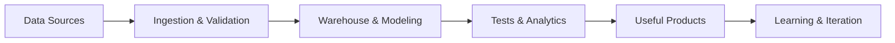

<!-- GitHub Profile README | Tarek-Radi | November 2026 -->

  

  

  <b>Aspiring Data Engineer · AI Systems Builder · Engineering Student</b> 
  Helwan University, Egypt · Communications & Information Engineering · Expected graduation: 2027

  
  
  

---

## About Me

I'm an engineering student who enjoys turning ideas and raw data into practical, documented software systems.

My **primary career direction is Data Engineering**, with an emphasis on SQL, data warehouses, ETL/ELT, orchestration, data quality, and a growing focus on **Microsoft Azure**. Alongside that path, I build **applied AI systems** involving local language models, tool calling, retrieval, and machine learning applications. I also enjoy taking projects beyond notebooks and into usable web interfaces.

**How I like to work:** design the system, build a working version, test assumptions, document the trade-offs, and iterate.

## What I'm Working On

- **Data engineering:** SQL-first warehouse modeling, Python pipelines, dbt, Airflow, and Docker; learning how to extend these patterns into Azure.
- **AI agents and retrieval:** building an assistant with explicit tools, PostgreSQL persistence, embeddings, and FAISS; deeper RAG integration and evaluation remain ongoing.
- **LLM fundamentals:** studying the internals of a bilingual Arabic-English GPT-style model from scratch in PyTorch; dataset exploration is complete, with tokenization and model implementation next.
- **Product engineering:** building and deploying web applications with practical validation and user-facing flows.

---

## Technical Toolbox

**Data engineering and databases**

**AI and application development**

**Currently learning:** Microsoft Azure data services, deeper LLM architecture, evaluation, and reliable AI application design.

---

## Featured Projects

These projects show both my **data engineering foundation** and my expanding work in **AI and product development**.

| Project | What it demonstrates | Stack / status |
|:--|:--|:--|
| 🛒 **[E-commerce Data Pipeline](https://github.com/Tarek-Radi/E-commerce-Data-Pipeline)** | Raw e-commerce data through ingestion, transformations, data-quality tests, and analytics-ready models | Python, PostgreSQL, Docker, Airflow, dbt |
| 🤖 **[AI Study Assistant](https://github.com/Tarek-Radi/ai-study-assistant)** | Local LLM tool calling, PostgreSQL task tools, embeddings, and FAISS semantic retrieval | Python, Ollama, PostgreSQL, FAISS · RAG integration ongoing |
| 🏭 **[Solid Waste Data Warehouse](https://github.com/Tarek-Radi/solid-waste-data-warehouse)** | Bronze/Silver/Gold layers, dimensional modeling, and advanced SQL analytics | SQL Server, T-SQL, ROLLUP, CUBE |
| 🧠 **[GenderClassy](https://github.com/Tarek-Radi/Gender-Classy)** | Dictionary-first name classification with ML fallback, batch file processing, and a live interface | Python, scikit-learn, Streamlit · [Demo](https://tarek-radi-gender-classy-app-80hycp.streamlit.app/) |
| 🛍️ **[VERA](https://github.com/Tarek-Radi/vera_1)** | A deployed fashion storefront with server-side validation, tests, and WhatsApp-based order submission | Next.js · [Live website](https://vera1-sigma.vercel.app/) |
| 🔤 **[NAWA-LLM](https://github.com/Tarek-Radi/nawa-llm)** | Learning to build a bilingual GPT-style model from scratch; data exploration completed | Python, PyTorch, Hugging Face Datasets · Work in progress |

### More Work

- **[SQL Data Warehouse Project](https://github.com/Tarek-Radi/SQL-Data-Wearhouse-Project)** — ERP/CRM integration, data cleaning, and star-schema analytics in SQL Server.
- **[Wuzzuf Job Scraper](https://github.com/Tarek-Radi/Wuzzuf-Job-Scraper)** — extracting and structuring job listings with Requests, BeautifulSoup, and Pandas.
- **[Spark Smart Energy Analytics](https://github.com/Tarek-Radi/spark-smart-energy-analytics)** — PySpark learning project for energy analytics; repository documents an initial setup stage.
- **[Nursery Web Project](https://github.com/Tarek-Radi/nursery-web-project)** — a React/Vite web project; not yet an AI-powered nursery management platform.
- **[Data Engineering Portfolio](https://github.com/Tarek-Radi/tarek-data-engineer-portfolio)** — project-focused portfolio website.

---

## My Engineering Focus

I am interested in building systems that are not only technically interesting but also understandable, maintainable, and useful to people.

### A Longer-Term Vision

I'm also exploring a future direction at the intersection of **early-childhood education and responsible technology**: tools that may help nurseries manage operations, document child development, and communicate with parents. This is a **future product vision**, not a claim that a child assessment or nursery AI platform has already been built or validated. Privacy, child safety, and expert oversight would be essential to that work.

---
<!-- Paste this section in your profile README.md just before "## Let's Connect". -->
<!-- All metrics below are dynamic for Tarek-Radi, not hardcoded from other developers. -->

## Background

**B.Sc. in Communications & Information Engineering (AI Track)** — Helwan University, Egypt · **Expected graduation: 2027**

**Training & learning:** AVR Diploma (IMT) · NTI Machine Learning Training · AI Ambassadors Program · Hands-on Data Engineering and Applied AI projects

---

## GitHub Stats & Contributions

  
  

  

### Contribution Activity

  

  

Live statistics use publicly available GitHub activity. Language percentages reflect code in repositories, not skill level. Third-party image services can be temporarily unavailable.

---
## Let's Connect

I welcome thoughtful conversations about **Data Engineering, applied AI, and collaborative software projects**.

- **GitHub:** [Tarek-Radi](https://github.com/Tarek-Radi)
- **LinkedIn:** [Tarek Mahmoud Abdelrady](https://www.linkedin.com/in/tarek-mahmoud-abdelrady-404884354/)

<i>Build with curiosity. Ship with care. Keep learning.</i>

  

